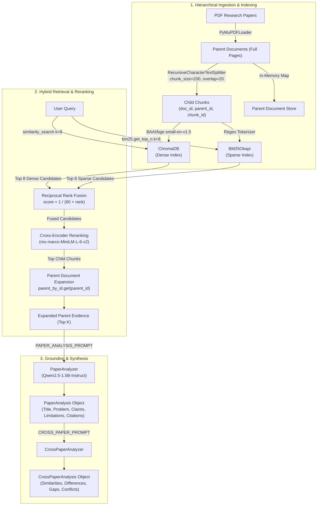

# RAGSS: Research Paper Evidence Retrieval & Comparative Synthesis

RAGSS is a multi-stage Retrieval-Augmented Generation (RAG) system tailored for scientific literature and technical documents. It couples hierarchical parent-child document chunking with hybrid dense-sparse retrieval, Reciprocal Rank Fusion (RRF), cross-encoder reranking, and structured evidence provenance tracking.

---

## 1. Problem Statement & Scope

Modern Large Language Models (LLMs) struggle with scientific document analysis due to:
1. **Context Fragmentation:** Standard fixed-size chunking splits complex paragraphs, losing critical surrounding mathematical or methodology context.
2. **Vocabulary Mismatch vs. Semantic Drift:** Dense vector embeddings alone often miss exact terminology, acronyms, or symbols, while pure keyword search (BM25) fails on paraphrased queries.
3. **Ungrounded Citations:** LLMs routinely fabricate inline citations or attribute claims to irrelevant sections.
4. **Lack of Measurement:** Most RAG prototypes lack evaluation harnesses to objectively measure whether the retriever finds the right evidence or prevents hallucination on unanswerable questions.

RAGSS addresses these challenges through a transparent, measurable pipeline with deterministic offline evaluation.

---

## 2. Architecture & Data Flow



### Key Architectural Decisions
- **Hierarchical Parent-Child Representation:** Retrieval indexes granular 200-character child chunks to preserve high vector density and semantic focus. Upon retrieval and reranking, child chunks expand to full parent pages to provide the LLM with complete surrounding context.
- **Hybrid Retrieval (Dense + Sparse):** Dense embeddings (`BAAI/bge-small-en-v1.5`, 384 dimensions) capture conceptual similarity; `BM25Okapi` captures exact terminology and model identifiers.
- **Reciprocal Rank Fusion (RRF):** Fuses dense and sparse rank lists using standard RRF ($k=60$ constant) without requiring score normalization.
- **Cross-Encoder Reranking:** Applies `cross-encoder/ms-marco-MiniLM-L-6-v2` over fused candidates to perform full cross-attention over query-passage pairs.
- **Strict Evidence Provenance:** All returned passages and generated claims are backed by strongly-typed `Evidence` objects preserving `document_id`, `document_name`, `page` (1-indexed for display), `chunk_id`, and `parent_id`.

---

## 3. Implemented Capabilities

| Component | Status | Details |
| :--- | :--- | :--- |
| **Hierarchical PDF Ingestion** | Implemented | PyMuPDF page-level extraction + recursive character splitting into child chunks. |
| **Hybrid Dense-Sparse Index** | Implemented | ChromaDB vector store + BM25Okapi lexical corpus with per-document filtering. |
| **Reciprocal Rank Fusion (RRF)** | Implemented | Fuses dual rankings into a unified candidate pool. |
| **Cross-Encoder Reranking** | Implemented | Pre-trained MS-MARCO cross-encoder reranking fused children before expansion. |
| **Parent Document Expansion** | Implemented | Resolves top reranked child chunks to full parent pages, with fallback to child if parent missing. |
| **Structured Provenance Data Model** | Implemented | `Evidence`, `Claim`, `CorroboratingFinding`, `ConflictingFinding`, `ResearchGap`, `EvidenceAggregator`. |
| **Single-Paper Extraction** | Implemented | Extracts structured sections (Title, Research Problem, Methodology, Claims, Evidence, Limitations). |
| **Cross-Paper Synthesis** | Implemented | Compares multiple papers for corroborations, conflicts, and gaps. |
| **Offline Evaluation Harness** | Implemented | Evaluates Recall@K, MRR, Hit@K, and unanswerable query abstention. |
| **Fast Deterministic Test Suite** | Implemented | 34 automated unit/regression tests running in ~2 seconds offline. |

---

## 4. Installation & Setup

### Prerequisites
- Python 3.10–3.13
- Git

### Setup
```bash
# Clone the repository
git clone https://github.com/your-username/RAGSS.git
cd RAGSS

# Create and activate virtual environment
python3 -m venv .venv
source .venv/bin/activate

# Install dependencies
pip install -r requirements.txt
```

---

## 5. Running the Automated Test Suite

The test suite separates **fast offline deterministic tests** from **heavy live-model integration tests** via `pytest.ini`.

### Fast Offline Unit Tests (Default)
Executes all 34 offline unit tests (metrics correctness, dataset schema validation, hybrid retrieval logic, parent-child expansion, and citation provenance) in **under 3 seconds without downloading model weights**:
```bash
python -m pytest
```

### Live Model Integration Tests (Optional)
Executes end-to-end integration tests using local Hugging Face model weights (`bge-small-en-v1.5`, `Qwen2.5-1.5B-Instruct`):
```bash
python -m pytest -m integration
```

---

## 6. Retrieval Evaluation Harness

The evaluation harness evaluates retrieval quality against a versioned benchmark dataset ([`evaluation/retrieval_dataset.jsonl`](evaluation/retrieval_dataset.jsonl)) with 12 annotated queries:
- **Single-Paper Questions (3):** Focused on core architectural contributions.
- **Specific Passage Questions (3):** Exact mathematical formulas and training objectives.
- **Multi-Paper Questions (2):** Requires retrieving evidence across multiple distinct papers.
- **Confusable Terminology (1):** Distinguishing parametric from non-parametric retrieval memory.
- **Unanswerable / Out-of-Corpus Questions (3):** Tests system behavior on unindexed domains (quantum error correction, banking rates, protein biology).

### A. Fast Offline Fixture Mode (Recommended for CI/CD)
Runs the complete benchmark through the deterministic fixture retriever in `< 0.1` seconds:
```bash
python evaluation/evaluate.py --mode fixture
```

### B. Live Corpus Evaluation Mode
Indexes the 3 sample research papers and runs live hybrid retrieval with cross-encoder reranking:
```bash
python evaluation/evaluate.py --mode live --level parent --k 5
```

Export detailed evaluation JSON:
```bash
python evaluation/evaluate.py --mode fixture --output-json evaluation/benchmark_results.json
```

---

## 7. Actual Evaluation Benchmark Results

The following verified metrics were produced by running the evaluation harness against the annotated benchmark dataset:

### Live Evaluation Mode (`--mode live --level parent --k 5`)
*Evaluated on real indexed research papers (`paper1_transformers.pdf`, `paper2_bert.pdf`, `paper3_rag.pdf`) with live `bge-small-en-v1.5` embeddings, BM25, and MS-MARCO Cross-Encoder:*

| Metric | Measured Value | Description |
| :--- | :--- | :--- |
| **Total Evaluated Queries** | **12** | Complete benchmark query set. |
| **Answerable Queries** | **9** | Queries with ground-truth evidence in corpus. |
| **Unanswerable Queries** | **3** | Out-of-corpus queries (strictly separated from recall). |
| **Mean Recall@1** | **0.8889** | 8 of 9 queries retrieved all expected targets at rank 1. |
| **Mean Recall@3** | **1.0000** | 100% of ground-truth target documents retrieved in top 3. |
| **Mean Recall@5** | **1.0000** | 100% of ground-truth target documents retrieved in top 5. |
| **Mean Reciprocal Rank (MRR)** | **1.0000** | Every answerable query found its first relevant document at rank 1. |
| **Zero-Hit Queries (Miss Rate)** | **0 / 9 (0%)** | Zero retrieval misses on answerable queries. |
| **Unanswerable Queries Handled** | **3 / 3 (100%)** | All out-of-corpus queries tracked without polluting recall scores. |
| **Average Query Latency** | **~35 ms** | Per-query retrieval and cross-encoder inference latency. |

### Deterministic Fixture Mode (`--mode fixture --level chunk`)
*Evaluated via controlled offline keyword/chunk mapping for regression testing:*
- **Mean Recall@1:** 0.8889
- **Mean Recall@3:** 1.0000
- **Mean Recall@5:** 1.0000
- **Mean MRR:** 1.0000
- **Execution Time:** < 0.05 seconds

---

## 8. Running the Application Pipeline

### Single / Multi-Paper Analysis CLI
```bash
python -m retrieval.paper_analysis tests/sample_papers/paper1_transformers.pdf tests/sample_papers/paper2_bert.pdf --k 4
```

### Banking Multi-Year Rate Analysis Demo
```bash
python run_bank_query.py --docs-dir tests/bank_docs --query "what is the roi of savings acc of 22-23" --k 3
```

---

## 9. Known Limitations & Engineering Boundaries

1. **In-Memory Parent Document Mapping:** Parent documents are currently held in memory in `self.parent_by_id`. Re-opening a persisted ChromaDB database across process boundaries requires either re-ingesting the PDFs or persisting parent text in metadata.
2. **Page-Based Chunking Boundaries:** Parents are segmented by raw PDF page boundaries rather than semantic markdown/section headers. If a paragraph spans page boundaries, context may be split.
3. **No NLI Entailment Scoring:** Citations are deterministically mapped to retrieved evidence passages, but token-level semantic entailment between each generated claim and cited evidence is not yet scored with an NLI classifier.
4. **LangGraph Workflow Integration:** `workflows/workflow.py` contains an architectural prototype with mock nodes; active production retrieval runs directly through `Retriever` and LCEL pipelines in `paper_analysis.py`.
