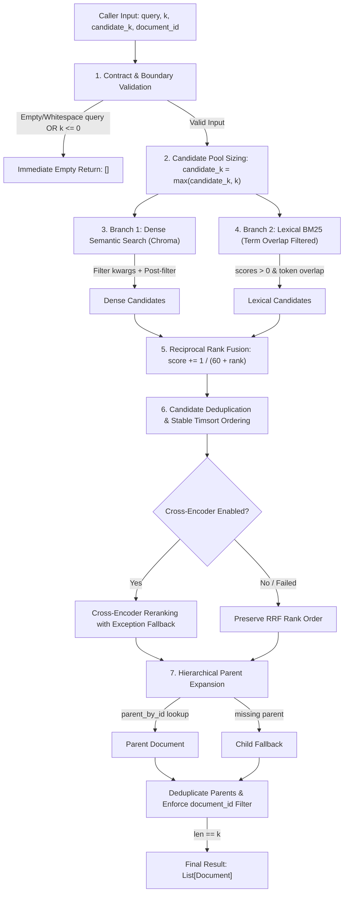

# Engineering Record: Package 2 — Retrieval Correctness & Invariants

## 1. Executive Summary
In Phase 2, we conducted a rigorous audit of the core hybrid retrieval engine in PaperTrail ([`retrieval/retriver.py`](file:///Users/suhaas/Projects/RAGSS/retrieval/retriver.py)), tracing execution from query input through dense semantic search, lexical BM25, Reciprocal Rank Fusion (RRF), cross-encoder reranking, and hierarchical parent-child expansion.

We identified and resolved five concrete correctness defects:
1. **Zero / Negative $K$ Bypass**: Requesting `k=0` or negative $k$ bypassed loop termination and returned *all* candidate documents instead of zero.
2. **ZeroDivisionError in Index Rebuilding**: Calling `rebuild_index()` with an empty document collection crashed with `ZeroDivisionError: division by zero` in `rank_bm25`.
3. **Lexical Hallucinations on Zero Overlap**: BM25's `get_top_n()` returned documents even when query tokens had zero lexical overlap (score 0.0), feeding irrelevant chunks with artificial RRF score boosts.
4. **Orphan Chunk Loss**: Storing `None` in `seen_parent_ids` when expanding orphan chunks blocked all subsequent distinct orphan chunks from being retrieved.
5. **Permissive Mock in Filtering Tests**: `MockVectorStore` completely ignored `kwargs` (including `filter={"document_id": ...}`), creating false confidence in filter test coverage.

All fixes were implemented autonomously and validated with 14 unit and regression tests, bringing the total passing test suite to 52 tests with zero regressions.

---

## 2. Architecture & Execution Path Tracing



---

## 3. Audit Findings: Confirmed Defects vs. Speculative Risks

| Finding | Severity | Status | Concrete Evidence / Root Cause |
| :--- | :--- | :--- | :--- |
| **1. `k <= 0` returns all documents** | **High** | **Confirmed & Fixed** | In `retriver.py`, `if len(parent_documents) == k:` checked equality at the *end* of each iteration. When `k=0`, `len` is already 1, so the condition is never met, returning all documents. |
| **2. Empty corpus crashes `rebuild_index`** | **Medium** | **Confirmed & Fixed** | When `documents = []`, `BM25Okapi([])` crashed with `ZeroDivisionError: division by zero` in `rank_bm25` initialization. |
| **3. Zero-overlap BM25 candidates** | **High** | **Confirmed & Fixed** | `BM25Okapi.get_top_n()` returns arbitrary documents when all scores are 0.0. In RRF, these zero-overlap documents received artificial score boosts ($1/(60+rank)$). |
| **4. Broken orphan chunk deduplication** | **Medium** | **Confirmed & Fixed** | If a chunk had `parent_id = None`, `seen_parent_ids.add(None)` was executed. Subsequent distinct orphan chunks evaluated `if None in seen_parent_ids` as `True` and were dropped. |
| **5. Deceptive vector store filter mock** | **Medium** | **Confirmed & Fixed** | `MockVectorStore` in `tests/test_hybrid_retrieval.py` discarded `**kwargs`, never validating that `filter={"document_id": ...}` was passed to the vector store. |
| **6. Uncalibrated hybrid candidate pool** | **Low** | **Confirmed & Fixed** | Requesting `k=10` with default `candidate_k=8` caused the retriever to retrieve at most 8 candidates, never satisfying $k=10$. |
| **7. Cross-encoder single point of failure** | **Low** | **Confirmed & Fixed** | If `cross_encoder.predict()` threw an exception (e.g., OOM, string formatting), the entire retrieval call failed rather than gracefully falling back to RRF rank order. |

---

## 4. Changes Made & Technical Rationale

### A. Strict Input Boundaries
- **Query**: If `query is None`, not a string, or `not query.strip()`, immediately return `[]`. Running vector and BM25 search on empty strings wastes compute and returns arbitrary noise.
- **$k$ Cutoff**: Clamped to `if k <= 0: return []`.
- **Candidate Pool ($candidate\_k$)**: Automatically set to `max(candidate_k, k)` so the initial pool can always fulfill the requested result count.

### B. Positive-Overlap BM25 Candidate Invariant
- We cached `_doc_token_sets = [set(tokens) for tokens in tokenized_corpus]` upon initialization and index rebuilding.
- In `retrieve()`, candidate documents are restricted to those where `bool(query_token_set.intersection(self._doc_token_sets[idx]))`.
- Documents with zero token overlap receive no rank in BM25, preventing false lexical hits on out-of-domain queries.

### C. Separate Parent vs. Orphan Deduplication
- We decoupled resolved parents from orphan chunks by tracking `seen_parent_ids: Set[str]` and `seen_chunk_keys: Set[Any]`.
- Non-existent `parent_id = None` is never stored in `seen_parent_ids`, preventing orphan chunk starvation.

### D. Multi-Layer Filter Invariant
- Dense search forwards `search_kwargs["filter"] = {"document_id": document_id}` and post-filters returned candidates.
- BM25 candidate selection filters by `document_id`.
- Parent expansion and orphan fallback explicitly verify `doc.metadata.get("document_id") == document_id`.

### E. Cross-Encoder Fault Tolerance
- Wrapped `cross_encoder.predict()` in a `try...except Exception` block that logs a warning and falls back to RRF ordering if inference fails.

---

## 5. Verification & Test Results

### Commands Executed & Outcomes
1. **Targeted Hybrid & Parent-Child Tests**:
   ```bash
   ./.venv/bin/pytest tests/test_hybrid_retrieval.py tests/test_parent_child.py
   ```
   - **Result**: `14 passed in 2.09s`
2. **Full Repository Non-Integration Test Suite**:
   ```bash
   ./.venv/bin/pytest
   ```
   - **Result**: `52 passed, 4 deselected in 2.24s`
   - *Note on deselected tests*: 4 tests marked with `@pytest.mark.integration` (`test_multi_document_pipeline`, `test_bank_rates_query_execution`, etc.) require live model weights and persistent disk storage and were intentionally deselected by `addopts = -m "not integration"` in `pytest.ini`.
3. **Deterministic Evaluation Harness**:
   ```bash
   ./.venv/bin/python evaluation/evaluate.py --mode fixture
   ```
   - **Result**: 12 queries evaluated. Mean R@1: 0.8889, R@3: 1.0000, R@5: 1.0000, MRR: 1.0000. Clean Abstentions: 3/3, False Positives: 0/3.

---

## 6. Remaining Risks & Deferred Decisions

1. **Live Model Download on Import / Initialization**:
   `Embed.__init__` instantiates `HuggingFaceEmbeddings("BAAI/bge-small-en-v1.5")` and references a hardcoded path in `Path.home() / "Downloads"`. This is an ingestion architecture issue deferred to **Phase 3: Ingestion and Stable Identity**.
2. **Chroma Global Persistence Isolation**:
   `index_documents()` uses `vector_store.delete(ids=existing_ids)` which relies on `vector_store.get()`. In collections exceeding Chroma's batch limit, chunking deletion across batches or recreating the collection safely should be addressed in Phase 3.
