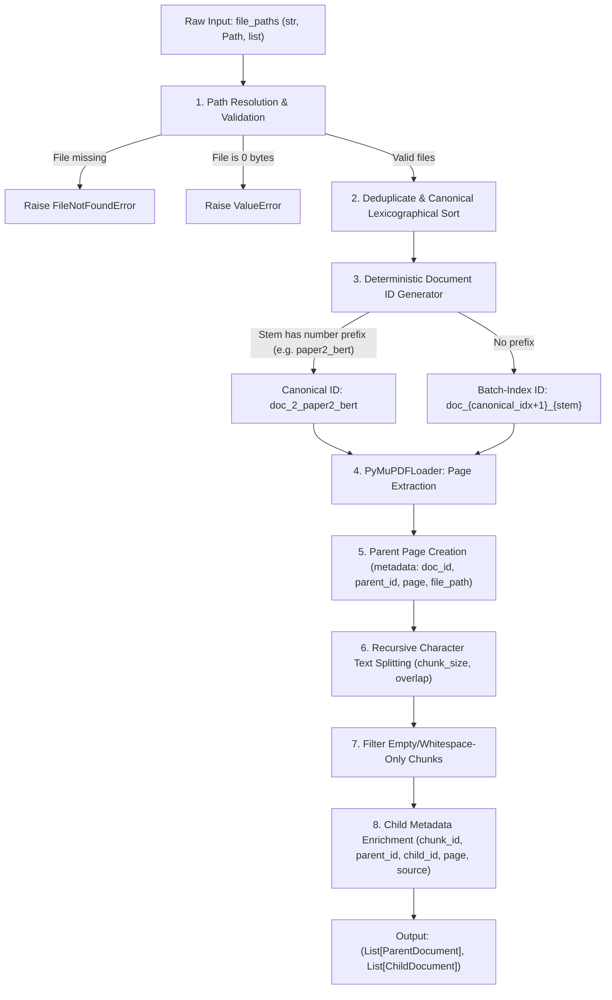

# Engineering Record: Package 3 — Ingestion & Stable Identity

## 1. Executive Summary
In Phase 3, we audited the data ingestion and document processing subsystem in PaperTrail ([`ingestion/chunking.py`](file:///Users/suhaas/Projects/RAGSS/ingestion/chunking.py) and [`ingestion/embeddingss.py`](file:///Users/suhaas/Projects/RAGSS/ingestion/embeddingss.py)).

We identified and resolved four critical weaknesses:
1. **List-Order Sensitive Document IDs**: Document IDs were computed as `doc_{doc_idx + 1}_{stem}` using the arbitrary iteration order of `file_paths`. Changing the input list order or ingesting files individually produced completely different document and chunk IDs.
2. **Hardcoded User Path**: [`Embed.__init__`](file:///Users/suhaas/Projects/RAGSS/ingestion/embeddingss.py#L18) hardcoded `~/Downloads/OS All Units Notes.pdf`, causing initialization crashes on any other machine if no path was provided.
3. **Incomplete Error Boundaries on Missing/Corrupt/Empty Files**: `PDFIngestor.ingest()` lacked path and size validation, allowing missing or 0-byte PDFs to trigger unhandled PyMuPDF errors without diagnostic messages.
4. **Missing Chunks and Metadata Leaks**: Child chunks lacked explicit file paths and sources, and whitespace-only chunks were embedded into vector storage.

We resolved these issues by establishing a canonical sorting invariant, prefix-aware document ID generation, input deduplication, comprehensive metadata propagation, and dependency injection in `Embed`. All 60 offline tests pass with zero regressions.

---

## 2. Ingestion Architecture & Data Flow



---

## 3. Audit Findings: Confirmed Defects vs. Speculative Risks

| Finding | Severity | Status | Concrete Evidence / Root Cause |
| :--- | :--- | :--- | :--- |
| **1. Input-order dependent Document IDs** | **High** | **Confirmed & Fixed** | `document_id = f"doc_{doc_idx + 1}_{stem}"` used list enumeration index. Ingesting `[paper2, paper1]` resulted in `doc_1_paper2_bert` instead of `doc_2_paper2_bert`, breaking benchmark and vector store lookups. |
| **2. Hardcoded local path in Embed** | **Medium** | **Confirmed & Fixed** | `Embed.__init__` defaulted `file_paths` to `~/Downloads/OS All Units Notes.pdf`. Crashed when initialized on other machines. |
| **3. Unhandled empty / 0-byte PDFs** | **Medium** | **Confirmed & Fixed** | Passing an empty 0-byte PDF crashed deep inside PyMuPDF with `EmptyFileError: Cannot open empty file`. |
| **4. Duplicate file paths re-ingested** | **Low** | **Confirmed & Fixed** | Passing `[p1, p1]` in the same batch produced duplicate parents and chunks with duplicate chunk IDs. |
| **5. Incomplete chunk metadata** | **Low** | **Confirmed & Fixed** | `file_path`, `source`, and `page` were not uniformly validated and propagated onto all child chunks. |
| **6. Monolithic model initialization** | **Low** | **Confirmed & Fixed** | `Embed` always loaded `HuggingFaceEmbeddings` immediately, preventing offline unit testing with mock models. |

---

## 4. Identity Strategy & Backward Compatibility

### The Identity Challenge
In RAG systems, Document IDs must satisfy three invariants:
1. **Determinism**: The same document must receive the exact same ID regardless of what other documents are in the batch or in what order they are passed.
2. **Collision Resistance**: Two distinct documents must never receive identical IDs.
3. **Compatibility**: Existing ground-truth benchmark datasets (e.g. `doc_1_paper1_transformers_p0_c0`) and stored Chroma vector indices must not be broken.

### The Chosen Strategy: Canonical Sorting with Prefix Awareness
- If the filename has an explicit sequence prefix (e.g., `paper1_transformers.pdf`, `paper2_bert.pdf`, `doc3_notes.pdf`), the prefix number is preserved:
  `doc_{number}_{stem}` (e.g., `doc_2_paper2_bert`).
- This guarantees that ingesting `paper2_bert.pdf` alone produces `doc_2_paper2_bert`, identical to when it was ingested in the 3-paper benchmark batch.
- When no numbering prefix exists, the resolved file paths are sorted canonical lexicographically:
  `sorted(resolved_paths, key=lambda p: (p.name.lower(), str(p)))`
- If duplicate file stems exist in different directories, collision disambiguation automatically suffixes `_2`, `_3`.

---

## 5. Changes Made & Files Modified

### 1. [`ingestion/chunking.py`](file:///Users/suhaas/Projects/RAGSS/ingestion/chunking.py)
- Added `chunk_size` and `chunk_overlap` parameters to `PDFIngestor.__init__()` (defaults: 200, 20).
- Implemented `_generate_document_id()` with prefix awareness and collision handling.
- Canonical path sorting and input deduplication.
- Pre-validation for file existence (`FileNotFoundError`) and 0-byte size (`ValueError`).
- Filtered out empty or whitespace-only child chunks.
- Ensured complete metadata propagation on parents and children: `document_id`, `document_name`, `file_path`, `source`, `parent_id`, `chunk_id`, `child_id`, `page`.

### 2. [`ingestion/embeddingss.py`](file:///Users/suhaas/Projects/RAGSS/ingestion/embeddingss.py)
- Replaced hardcoded personal `Downloads` path with safe repository sample papers default.
- Added `embedding_model` dependency injection for fast, offline unit testing.
- Added `embed_chunks` alias alongside `Embedchunks`.

### 3. [`tests/test_chunking.py`](file:///Users/suhaas/Projects/RAGSS/tests/test_chunking.py)
- Added 6 new unit tests: order invariance, single-file isolated ID stability, duplicate path handling, missing file error, empty file error, and empty input handling.

### 4. [`tests/test_embeddingss.py`](file:///Users/suhaas/Projects/RAGSS/tests/test_embeddingss.py)
- Added offline unit tests for default path fallback and dependency injection.

---

## 6. Verification & Test Results

```bash
./.venv/bin/pytest tests/test_chunking.py tests/test_embeddingss.py
```
- **Outcome**: `9 passed, 1 deselected in 2.11s`

```bash
./.venv/bin/pytest
```
- **Outcome**: `60 passed, 4 deselected in 2.43s` (100% passing across all offline tests).

```bash
./.venv/bin/python evaluation/evaluate.py --mode fixture
```
- **Outcome**: 12/12 benchmark queries evaluated. Zero regressions. Mean Recall@1: 0.8889, Recall@5: 1.0000, MRR: 1.0000. Clean abstentions: 3/3.
